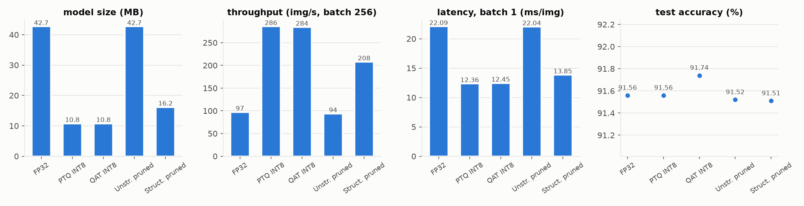
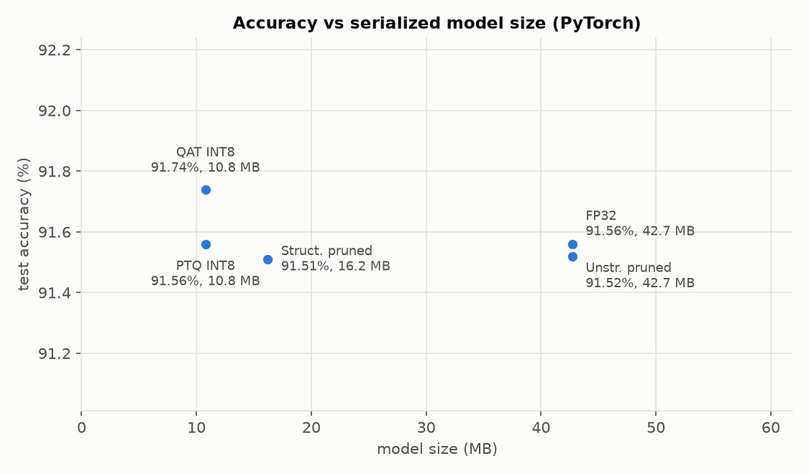
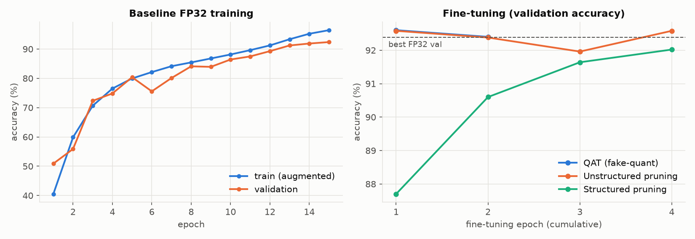
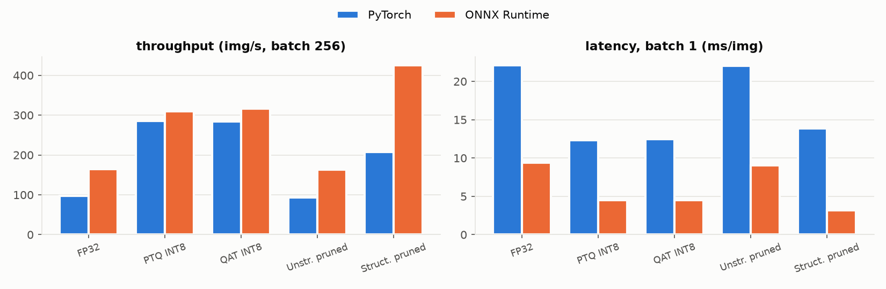

# Technical Report: Quantization and Pruning of ResNet-18 on CIFAR-10

**Course:** Edge Computing, Assignment 03 · **Platform:** CPU-only laptop (AMD Ryzen 5 PRO 5650U,
6C/12T, AVX2, no VNNI, 16 GB RAM), Windows 11, Python 3.12.10, PyTorch 2.14.0+cpu, ONNX Runtime 1.32.0.

Every number in this report comes from the CSV/JSON files in `results/`, produced by the scripts
in this repository. The full auto-generated tables are in [results_tables.md](results_tables.md).

---

## 1. Architecture and implementation

### 1.1 Model: ResNet-18 for CIFAR-10 (`models/resnet.py`)
* Stem: 3×3 conv (stride 1, 64 ch) + BN + ReLU. The ImageNet 7×7/stride-2 conv and max-pool are
  removed because 32×32 inputs would otherwise be down-sampled 4× immediately.
* 4 stages × 2 BasicBlocks with widths 64/128/256/512, strides 1/2/2/2. Stages 2–4 use 1×1 conv +
  BN projection shortcuts. Global average pooling, then a 10-way linear classifier.
  11,173,962 parameters, 555.4 M MACs per image (conv + fc, measured by `core/flops.py`).
* **Quantization ready:** `QuantStub`/`DeQuantStub` at the boundaries, one ReLU module per use,
  and the residual sum written as `FloatFunctional.add_relu`, so after conversion it becomes the
  INT8 kernel `quantized::add_relu`. `fuse_model()` lists every Conv-BN-ReLU / Conv-BN group.
* **Width configurable:** every block takes its own `(in, mid, out)` channel counts. Structured
  pruning uses this to instantiate a genuinely smaller network.

### 1.2 Data pipeline (`core/data.py`)
CIFAR-10 is held in memory as uint8 tensors. Seeded split (seed 42): 45,000 train / 5,000
validation / 10,000 test. Training augmentation is a 4-px padded random crop plus a horizontal
flip, vectorised over the batch. All inputs are normalised with the CIFAR-10 mean/std. Model
selection uses the validation split only, and the test split is touched only for final
evaluation. All randomness (split, shuffling, augmentation, initialisation) is seeded.

### 1.3 Baseline training (`scripts/train.py`)
SGD (momentum 0.9, Nesterov, weight decay 5e-4), batch 128, OneCycle LR (peak 0.1, 25 % warm-up),
15 epochs, cross-entropy. The checkpoint with the best validation accuracy is kept. The full
training state is saved every epoch (`--resume`). Inputs use channels-last memory format on CPU
(≈15 % faster convolutions).

---

## 2. Quantization

### 2.1 PTQ vs QAT
| | Post-Training Quantization (static) | Quantization-Aware Training |
|---|---|---|
| Training needed | none: only a forward pass over calibration data | fine-tuning with fake quantization |
| How ranges are found | observers record activation statistics on calibration images | moving-average observers during training; weights *learn* to tolerate rounding (straight-through estimator) |
| Cost | seconds to minutes | one or more training epochs |
| Accuracy | small drop, larger for sensitive models / low bit-widths | usually recovers most of the PTQ drop |

Both produce the same deployable artefact: a model whose Conv/Linear layers run INT8 kernels
with INT8 per-channel weights and UINT8 activations.

### 2.2 Backend and qconfig (`core/quant.py`)
The quantized engine is picked automatically in the order x86 → fbgemm → onednn → qnnpack.
This PyTorch 2.14 Windows wheel only ships **onednn**, so all INT8 results use onednn.

* Weights: symmetric **per-channel** INT8 (`PerChannelMinMaxObserver`, `qint8`).
* Activations: affine per-tensor UINT8. PTQ uses `HistogramObserver`, which minimises the
  quantization error of the histogram instead of using raw min/max, so outliers matter less.
* `reduce_range=True` (7-bit activations). On x86 CPUs **without VNNI**, as here, the u8×s8
  multiply-add instruction (`vpmaddubsw`) accumulates pairs in int16 and can saturate. PyTorch
  itself warns about this for the oneDNN default qconfig. The reduced range is fbgemm's default and
  removes the overflow risk. `--no-reduce-range` is available for VNNI CPUs.

### 2.3 PTQ procedure (`scripts/ptq.py`)
1. Load the FP32 checkpoint and switch to eval mode.
2. Fuse 21 Conv-BN(-ReLU) groups: the stem, conv1-bn1-relu1 and conv2-bn2 in every block, and
   the shortcut conv-bn. Fusion folds BN into the conv weights and leaves accuracy unchanged
   (verified, §5.3). The final Linear is not followed by BN/ReLU, so it has no fusion partner and
   is quantized alone.
3. `prepare` inserts observers. Calibration: 2,000 random **training** images, no augmentation.
4. `convert` swaps in INT8 modules (`QuantizedConvReLU2d`, `QuantizedConv2d`, `QFunctional.add_relu`,
   `QuantizedLinear`). The converted `state_dict` is saved with the engine name.

### 2.4 QAT procedure (`scripts/qat.py`)
1. Start from the FP32 checkpoint and fuse with `fuse_modules_qat`. BN stays live in
   `ConvBnReLU2d` / `ConvBn2d`, so it is folded during training.
2. QAT qconfig: `FakeQuantize` with `MovingAverageMinMaxObserver` (activations, UINT8, reduced
   range) and `MovingAveragePerChannelMinMaxObserver` (weights, per-channel symmetric INT8).
3. Fine-tune with SGD (lr 1e-3, cosine, weight decay 1e-4). BN running statistics are frozen after
   50 % of the steps and observers after 70 %, so the final steps train with fixed quantization
   parameters. Observers are disabled during validation passes, so validation data never
   changes the ranges.
4. `convert` turns the result into the same INT8 module structure as PTQ. The fake-quant model is
   also kept (`qat_fakequant.pth`).

---

## 3. Pruning

### 3.1 Unstructured vs structured
| | Unstructured (weight) pruning | Structured (channel) pruning |
|---|---|---|
| What is removed | individual weights (set to 0) | whole output channels / filters |
| Tensor shapes | unchanged (dense tensors with zeros) | genuinely smaller |
| Typical sparsity at iso-accuracy | very high (80–95 %) | moderate |
| Speed-up on dense hardware | **none** without sparse kernels | direct (fewer MACs, smaller memory) |
| Storage benefit | only with compression / sparse formats | direct |

### 3.2 Unstructured pruning (`scripts/unstructured_pruning.py`)
* **Criterion:** |w| ranked **globally** over every Conv2d and Linear weight (`prune.global_unstructured`
  + `L1Unstructured`). Layers with redundant weights lose more, and sensitive ones such as the
  1,728-weight stem conv lose less.
* **Iterative schedule:** k = 3 rounds reaching S = 80 % sparsity. Each round prunes the fraction
  1 − (1 − S)^{1/k} ≈ 41.5 % of the *remaining* weights, so sparsity goes 41.5 % → 65.8 % → 80 %.
  The model is fine-tuned after each round.
* **Masks:** during fine-tuning PyTorch keeps `weight_orig` plus a `weight_mask` buffer and recomputes
  `weight = weight_orig * weight_mask` in a forward pre-hook, so pruned weights stay exactly zero.
* **Permanence:** after the last fine-tuning, `prune.remove` folds the mask into a plain `weight`
  tensor and deletes the hook, `weight_orig` and `weight_mask`. The validation suite asserts that
  no `_orig`/`_mask` tensors or hooks remain.

### 3.3 Structured channel pruning (`core/structured.py`, `scripts/structured_pruning.py`)
**Residual constraint.** In a ResNet every block output is *added* to its input, so all tensors
on one stage's residual path must share the same channel indexing. Two kinds of channels are
treated differently:

1. **Block-internal channels** (output of `conv1` = input of `conv2`). They are private to one
   block and pruned per block. Importance of channel *c* is the L1 norm of its filter,
   ‖W_conv1[c]‖₁. **50 %** of them are removed.
2. **Residual-stream channels.** One *channel group* per stage collects every layer that writes
   into the stream: the stem conv (stage 1, whose blocks use identity shortcuts), `conv2` of both
   blocks, and the projection-shortcut conv. Importance of channel *c* is
   Σ_p ‖W_p[c]‖₁ / mean_c′‖W_p[c′]‖₁ over these producers. Per-layer normalisation puts each
   producer on the same scale. **25 %** of each group is removed from all producers at once,
   and from every consumer (next convs' input channels, shortcut convs, the fc input).

Kept counts are rounded up to a multiple of 8. A new `ResNet18(config)` is built with the reduced
widths and the surviving weight / BN slices are copied in. **No masks are involved.**
Correctness checks:

* with 0 % pruning, the rebuilt network reproduces the original logits **exactly** (max |Δ| = 0.0);
* `verify_dimensions` checks every producer/consumer pair, the identity vs projection shortcuts and
  the fc input, then runs a forward pass;
* the saved checkpoint stores the reduced config and reloads into a model of the smaller shape.

Resulting widths (stem 48; blocks as (in, mid, out)):
`(48,32,48) (48,32,48) | (48,64,96) (96,64,96) | (96,128,192) (192,128,192) | (192,256,384) (384,256,384)`.

---

## 4. Experimental configuration

All final results come from one full-budget run on the CPU described in the header. Baseline
training ran separately (15 epochs, ≈ 3.4 h). Everything after it ran through
`python main.py --stages qat unstructured structured onnx benchmark report`, which took 251.6 min;
the log is `runs/full_pipeline_log.txt`. Seed 42 throughout.

| Stage | Data | Hyper-parameters | Wall time |
|---|---|---|---|
| FP32 baseline | 45,000 train / 5,000 val | 15 epochs, SGD-Nesterov, batch 128, OneCycle peak lr 0.1, wd 5e-4 | ≈ 3.4 h (736–1120 s/epoch) |
| PTQ | 2,000 calibration images (train split) | onednn, per-channel weights, HistogramObserver, reduce_range | 31.5 s calibration |
| QAT | 45,000 train | 2 epochs, lr 1e-3 cosine, wd 1e-4, BN frozen at 50 %, observers at 70 % of steps | 51.4 min |
| Unstructured | 45,000 train | global L1, 3 rounds → 80 %, 1 epoch after each round + 1 final, lr 0.01 | 93.8 min |
| Structured | 45,000 train | 50 % internal / 25 % residual-stream channels, round to 8, 4 epochs, lr 0.02 | 44.9 min |
| Benchmark | full 10,000-image test set | batch 256, 10 warm-up batches, median of 3 timed passes; batch-1 latency over all 10,000 images; 6 threads | 48.4 min (PyTorch + ORT) |

**Benchmark method** (`scripts/benchmark.py`). Model loading is timed separately and excluded
from all latency numbers. Every model gets warm-up passes before timing. Throughput is measured
on pre-normalised batches of 256. Batch-1 latency uses `time.perf_counter()` around each single
forward pass, over all 10,000 test images, and reports mean, p50, p95 and p99. `torch.inference_mode()`
is on and the thread count is fixed. Size is the serialised checkpoint / `.onnx` file on disk;
the gzip column shows how compressible it is. Batched and batch-1 predictions agreed on 100 % of
images for every model.

## 5. Results

### 5.1 Main results (PyTorch, CPU, full 10,000-image test set)

| Model | Test acc (%) | Δ vs FP32 (pts) | Test loss | Size (MB) | Size ratio | gzip (MB) | Non-zero params | MACs (M) | Throughput (img/s) | Speed-up | Latency bs1 (ms) | Latency speed-up |
|---|---|---|---|---|---|---|---|---|---|---|---|---|
| Original FP32 | 91.56 | — | 0.2479 | 42.70 | 1.00× | 39.63 | 11.17 M | 555.4 | 97.3 | 1.00× | 22.09 | 1.00× |
| PTQ INT8 | 91.56 | 0.00 | 0.2489 | 10.78 | **3.96×** | 9.63 | 11.03 M | 555.4 | 285.7 | **2.94×** | 12.36 | 1.79× |
| QAT INT8 | **91.74** | +0.18 | 0.2599 | 10.78 | **3.96×** | 9.63 | 11.03 M | 555.4 | 284.3 | 2.92× | 12.45 | 1.77× |
| Unstructured-pruned (80 %) | 91.52 | −0.04 | 0.2676 | 42.70 | 1.00× | **12.24** | 2.24 M | 555.4 | 93.7 | 0.96× | 22.04 | 1.00× |
| Structured-pruned | 91.51 | −0.05 | 0.2561 | 16.19 | 2.64× | 15.01 | 4.23 M | **210.1** | 207.7 | 2.13× | 13.85 | 1.60× |

Sources: `results/benchmark_summary.csv`, `results/model_comparison.csv`. The INT8 models have
11,169,162 parameters, 4,800 fewer than FP32, because BatchNorm is folded into the convolutions.
About 1.2 % of their INT8 weights round to zero; this is quantization, not pruning.

**Is any accuracy difference real?** All five models are within 0.23 points of each other. On
10,000 images that is small enough to be noise, so we ran an exact McNemar test on the per-image
predictions (`results/predictions.csv`) against FP32:

| Model | Same prediction as FP32 | Only this model correct | Only FP32 correct | McNemar p |
|---|---|---|---|---|
| PTQ INT8 | 99.36 % | 27 | 27 | 1.00 |
| QAT INT8 | 98.79 % | 59 | 41 | 0.089 |
| Unstructured | 96.55 % | 143 | 147 | 0.86 |
| Structured | 94.60 % | 225 | 230 | 0.85 |

No compressed model is significantly better or worse than FP32 at the 5 % level. The QAT gain
(+0.18 pts) is the closest to significant but should be read as "no loss", not "an improvement".
The two extra QAT epochs at a small learning rate also act as extra fine-tuning of the baseline.

### 5.2 Training and fine-tuning

The baseline reaches its best validation accuracy (92.38 %) in the last epoch, as expected with
a OneCycle schedule. Train accuracy (96.4 %, measured on augmented data) is above validation, so
the model is not saturated, and a longer schedule would raise every model's absolute accuracy (§8).
The right panel shows the fine-tuning stages. QAT and unstructured pruning start at baseline
level and stay there. Structured pruning starts from a damaged network and recovers over its 4 epochs.

### 5.3 Quantization: PTQ vs QAT

* **PTQ gives up nothing.** BN fusion leaves accuracy unchanged (fused FP32: 91.56 %). After INT8
  conversion, test accuracy is still 91.56 % and the loss rises by only 0.001. PTQ changes 64 of
  10,000 predictions (27 gained, 27 lost). Per-channel weights, the histogram observer and a
  BN-folded ResNet with ReLU-bounded activations make this an easy case for PTQ.
* **QAT matches or slightly beats it:** fake-quant model 91.68 %, converted INT8 model 91.74 %
  test, 92.40 % val. Before any QAT training the fake-quant model already scored 92.30 % val, so
  there was almost no quantization error to recover. The cost is 51 min of training against 31 s
  of calibration.
* **Reduced-budget QAT data point** (kept for transparency, not the reported model). An earlier
  run, under a tighter deadline, used 1 QAT epoch on a 15,000-image subset and reached 91.49 %
  INT8 test (fake-quant 91.48 %). Its checkpoint and log are in `runs/reduced_budget/`. The
  difference from the full run (+0.25 pts) is within the noise level shown above.
* **Deployment gain:** both INT8 models are **3.96× smaller** (42.7 → 10.8 MB). Batched
  throughput is **2.9× higher** (97 → 285 img/s) and batch-1 latency is 1.8× lower
  (22.1 → 12.4 ms). The batch-1 gain is smaller because fixed per-call overheads
  (quantize/dequantize at the boundaries, op dispatch) weigh more on single images.
* **Conclusion:** for this model and data, PTQ is the better cost/benefit choice. QAT becomes
  worth its cost for models or bit-widths where PTQ loses accuracy (depthwise convolutions,
  4-bit, quantization-unfriendly activations), which did not happen here.

### 5.4 Pruning: unstructured vs structured

**Unstructured (80 % global sparsity).** 8,931,481 of 11,164,352 conv/fc weights are exactly
zero, and test accuracy drops by only 0.04 points.

| Round | Global sparsity | Val acc right after pruning | Val acc after fine-tuning |
|---|---|---|---|
| 1 | 41.5 % | 92.46 % | 92.58 % |
| 2 | 65.8 % | 90.80 % | 92.38 % |
| 3 | 80.0 % | 86.18 % | 92.58 % (after 2 epochs) |

Each pruning round costs more validation accuracy than the last, measured against the previous
round's fine-tuned value: +0.08 points (no loss) in round 1, −1.78 in round 2 and −6.20 in
round 3. One or two epochs of fine-tuning recover all of it. Global ranking spreads the sparsity
very unevenly: the stem conv keeps 90 % of its weights (10.4 % sparsity) and the fc layer 91 %
(8.9 %), while the late, over-parameterised `layer4` convolutions are 82–92 % sparse. This is the
reason for ranking globally instead of pruning each layer by the same amount.

However, the **dense file stays 42.7 MB and speed is unchanged** (0.96× throughput, 1.00× latency):
dense kernels multiply zeros like any other number. The sparsity only shows up as compressibility:
gzip shrinks the file to 12.2 MB (3.49×, against 1.08× for the FP32 file). Turning it into speed
would need sparse kernels or hardware support for sparsity, which neither PyTorch's dense CPU path
nor ONNX Runtime's default CPU provider uses.

**Structured (physical channel removal).** The rebuilt network has 4,227,706 parameters and
210.1 M MACs, both **2.64× fewer**. The file shrinks from 42.7 to 16.2 MB. Right after surgery the
accuracy collapses to 11.91 %, close to chance, because removing whole channels changes
every downstream activation distribution, including BN statistics. Four fine-tuning epochs bring it
back to **91.51 %** (−0.05 pts). The speed-up is real: 2.13× throughput and 1.60× batch-1
latency in PyTorch, and 2.57× / 2.93× in ONNX Runtime. It is below the 2.64× MAC reduction
because narrow layers use the CPU's vector units less efficiently and fixed overheads do not shrink.

| | Unstructured | Structured |
|---|---|---|
| Removed | 80 % of individual weights | 62 % of parameters (whole channels) |
| Accuracy change | −0.04 pts | −0.05 pts |
| Accuracy right after pruning | 86.2 % val (last round) | 11.9 % test |
| Fine-tuning used | 4 epochs | 4 epochs |
| File size | 42.7 MB (12.2 MB gzipped) | 16.2 MB |
| Speed-up on CPU | none | 2.1–2.9× |
| Needs special runtime? | yes, for any benefit | no |

### 5.5 Overall comparison

* **Best size and PyTorch speed:** INT8 (PTQ or QAT), at 4× smaller and 2.9× faster with no
  accuracy loss. On edge CPUs this is the first optimisation to apply.
* **Best speed under ONNX Runtime:** the structured-pruned model (425 img/s, 3.2 ms per image). ORT's
  FP32 kernels are very efficient and benefit directly from fewer MACs.
* **Unstructured pruning** gives the highest compression *ratio* on paper (80 % zeros) but no
  run-time gain on standard hardware. It mainly helps storage or transmission (compressed
  downloads) or sparse accelerators.
* The methods are complementary. Structured pruning followed by INT8 quantization should combine
  the 2.64× and 3.96× size reductions (≈ 10×). This was outside the assignment scope and was
  **not measured**.

## 6. ONNX export and ONNX Runtime results

### 6.1 Export and validation (`scripts/export_onnx.py`, `results/onnx_validation.csv`)

| Model | Exporter | Opset | File (MB) | Top-1 agreement with PyTorch (2,000 imgs) | Max \|Δ logit\| |
|---|---|---|---|---|---|
| FP32 | torch.export (dynamo) | 18 | 42.69 | 100.00 % | 9.5e-6 |
| PTQ INT8 | TorchScript (fallback) | 13 | 10.77 | 99.70 % | 0.47 |
| QAT INT8 | TorchScript (fallback) | 13 | 10.77 | 99.55 % | 0.40 |
| Unstructured | torch.export (dynamo) | 18 | 42.69 | 100.00 % | 1.1e-5 |
| Structured | torch.export (dynamo) | 18 | 16.20 | 100.00 % | 1.0e-5 |

Every file passes `onnx.checker`. Inputs have a dynamic batch dimension. `scripts/onnx_inference.py`
runs them with ONNX Runtime using only NumPy/Pillow preprocessing (resize to 32×32, CIFAR
mean/std normalisation, NCHW). It produced the same predictions as the PyTorch inference script
in the validation suite.

The float models are numerically identical (differences around 1e-5, at float32 rounding level).
On the full test set, ONNX and PyTorch predictions agree 100 %, 99.69 % (PTQ), 99.71 % (QAT),
100 % and 100 %.

### 6.2 Limitations of exporting quantized models

* **The torch.export (dynamo) exporter fails for both INT8 models.** The root cause is
  `AttributeError: __torch__.torch.classes.quantized.Conv2dPackedParamsBase ... does not have a field
  with name '__obj_flatten__'`: eager-mode INT8 layers keep their weights in opaque, packed
  TorchScript objects that `torch.export` cannot trace. The script records this error in
  `onnx/manifest.json` and falls back automatically.
* **The TorchScript exporter (opset 13)** turns `quantized::conv2d_relu`, `quantized::add_relu`
  and `quantized::linear` into **QDQ** form: `QuantizeLinear → DequantizeLinear → Conv/Gemm/Add`.
  Weights are stored as INT8 initialisers, which is why the file is 10.8 MB and not 42.7 MB. ONNX
  Runtime's graph optimiser can fuse QDQ patterns into integer kernels, and the measured 1.9–2.1× speed-up of the
  INT8 ONNX models over FP32 ONNX is consistent with that.
* **INT8 results are close, not bit-exact (99.55–99.70 % agreement, max |Δ logit| ≈ 0.4).**
  oneDNN (PyTorch) and ONNX Runtime use different integer accumulation and requantization
  rounding. One rounding step difference in an activation can then propagate. Accuracy is not
  affected (PTQ: 91.53 % ORT vs 91.56 % PyTorch; QAT: 91.70 % vs 91.74 %).
* The TorchScript exporter is itself deprecated. A future-proof INT8 route is to export the
  **float** model and quantize with ONNX Runtime's own tools (`onnxruntime.quantization`), or to
  use PT2E quantization (`torchao`) with the dynamo exporter. Both are outside this assignment.

### 6.3 PyTorch vs ONNX Runtime speed (`results/onnx_benchmark_summary.csv`)

| Model | PyTorch img/s | ORT img/s | PyTorch bs1 ms | ORT bs1 ms | ORT test acc |
|---|---|---|---|---|---|
| FP32 | 97.3 | 165.1 | 22.09 | 9.36 | 91.56 % |
| PTQ INT8 | 285.7 | 309.2 | 12.36 | 4.49 | 91.53 % |
| QAT INT8 | 284.3 | 316.7 | 12.45 | 4.50 | 91.70 % |
| Unstructured | 93.7 | 163.1 | 22.04 | 9.07 | 91.52 % |
| Structured | 207.7 | **424.9** | 13.85 | **3.19** | 91.51 % |

ONNX Runtime is faster than eager PyTorch for every model, especially at batch 1 (2.4–4.3×
lower latency), because it removes Python dispatch overhead and pre-optimises the graph. Under
ORT the structured-pruned FP32 model is the fastest of all five.

## 7. Validation

`python scripts/validate_project.py` passes **28/28 checks** (`results/validation_report.json`):
* `--help` on every script;
* load + CPU inference and an exact save → load round trip for all five checkpoints;
* 21 genuinely INT8 layers (qint8 weights, onednn) in both quantized models;
* 80.00 % permanent sparsity with no masks or hooks left;
* a physically smaller structured model with consistent dimensions;
* both inference scripts on all five models;
* ONNX agreement thresholds (≥ 99.9 % float, ≥ 95 % INT8);
* complete result CSVs (5 models × 10,000 predictions, 25 training-history rows).

**Smoke tests vs final results.** `python main.py --smoke` runs every stage on 1,024 training
images and 1,000 test images. It writes only to `runs/smoke/` and is a plumbing test whose
numbers are meaningless. Every checkpoint stores a `smoke_test` flag, all five final checkpoints
have `smoke_test = False`, and the benchmark records it in its `ckpt_smoke_test` column. No smoke
or reduced-budget number appears in §5–§6 except the clearly marked QAT data point in §5.3.

## 8. Limitations

* **Single run, single seed.** Differences below ≈ 0.3 points are not significant (§5.1). Several
  seeds would be needed to rank the methods on accuracy.
* **CPU-only, short schedules.** 15 baseline epochs give 91.6 %. Well-tuned CIFAR ResNet-18s reach
  95 % with 100–200 epochs, which was not feasible on a laptop CPU (≈ 13 min/epoch). The relative
  comparisons are the meaningful result here, not the absolute accuracy.
* **One CPU, one quantized engine.** Speed-ups were measured with onednn on a Zen 3 CPU without
  VNNI. On VNNI/AMX CPUs (with `--no-reduce-range`) or ARM (qnnpack) the INT8 gains would differ.
  Timing on a laptop also varies with thermal state and background load, which we limited
  by taking the median of three passes.
* **Unstructured sparsity** gives no measured speed-up, because no sparse runtime was used (§5.4).
* **Combined pruning + quantization** was not evaluated (§5.5).
